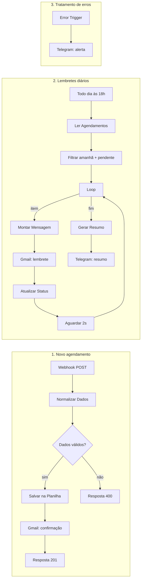

# 📅 Sistema de Lembretes de Agendamento — n8n

Automação feita em **n8n** que recebe agendamentos por API, salva os dados no **Google Sheets**, envia a confirmação por **Gmail** e, todos os dias, dispara **lembretes automáticos** para os clientes com agendamento no dia seguinte. O administrador recebe um resumo diário e alertas de erro pelo **Telegram**.

> Projeto final do curso de Automação com n8n.

---

## ✨ Funcionalidades

- **Recebimento de agendamentos** via Webhook (API REST)
- **Validação de dados**: campos obrigatórios, formato de e-mail, data e hora
- **Persistência** em Google Sheets
- **Confirmação imediata** por e-mail ao cliente
- **Lembrete automático** enviado às 18h para os agendamentos do dia seguinte
- **Controle de status** (`pendente` → `lembrete_enviado`) para evitar envios duplicados
- **Resumo diário** da agenda enviado ao administrador no Telegram
- **Monitoramento de erros** com alerta no Telegram

---

## 🔄 Fluxos

O workflow tem três fluxos independentes:



---

## 🧩 Nós utilizados

| Nó | Uso no projeto |
|---|---|
| **Webhook** | Recebe novos agendamentos via `POST /agendamento` |
| **Edit Fields (Set)** | Normaliza dados e monta o conteúdo das mensagens |
| **If** | Valida os campos obrigatórios e os formatos |
| **Google Sheets** | Insere, lê e atualiza os agendamentos |
| **Gmail** | Envia a confirmação e o lembrete ao cliente |
| **Respond to Webhook** | Retorna `201` (sucesso) ou `400` (erro) para quem chamou a API |
| **Schedule Trigger** | Executa a rotina de lembretes todo dia às 18h |
| **Code** | Filtra os agendamentos de amanhã e gera o resumo do dia |
| **Loop Over Items** | Processa um agendamento por vez |
| **Wait** | Pausa entre os envios para não estourar o limite do Gmail |
| **Telegram** | Envia o resumo diário e os alertas de erro ao administrador |
| **Error Trigger** | Captura falhas do workflow |

---

## 📋 Pré-requisitos

- n8n (self-hosted via Docker/npm ou n8n Cloud)
- Conta Google (Sheets + Gmail)
- Bot do Telegram (criado pelo [@BotFather](https://t.me/BotFather)) e o seu Chat ID

---

## 🚀 Como usar

### 1. Subir o n8n (Docker)

```bash
docker run -it --rm --name n8n -p 5678:5678 -e GENERIC_TIMEZONE="America/Sao_Paulo" -e TZ="America/Sao_Paulo" -v n8n_data:/home/node/.n8n docker.n8n.io/n8nio/n8n
```

Acesse `http://localhost:5678`.

### 2. Criar a planilha

1. Crie uma planilha no Google Sheets com uma aba chamada **`Agendamentos`**.
2. Importe o arquivo [`planilha-modelo.csv`](./planilha-modelo.csv) ou crie os cabeçalhos manualmente:

```
id | nome | email | telefone | servico | data | hora | status | criado_em
```

3. Formate as colunas **data** e **hora** como **Texto simples** (*Formatar → Número → Texto simples*). Assim o Sheets não converte `2026-10-22` em outro formato.
4. Copie o **ID da planilha**. Ele fica na URL:
   `https://docs.google.com/spreadsheets/d/`**`ESTE_E_O_ID`**`/edit`

### 3. Importar o workflow

1. No n8n: **Workflows → Import from File** → selecione `lembretes-agendamento.json`.
2. Configure as credenciais:
   - **Google Sheets OAuth2** nos nós *Salvar na Planilha*, *Ler Agendamentos* e *Atualizar Status*
   - **Gmail OAuth2** nos nós *Enviar Confirmação* e *Enviar Lembrete*
   - **Telegram API** (token do bot) nos nós *Resumo para o Admin* e *Alertar Erro*
3. Substitua os placeholders:
   - `COLE_AQUI_O_ID_DA_PLANILHA` → ID da sua planilha (3 nós)
   - `COLE_AQUI_SEU_CHAT_ID` → seu Chat ID do Telegram (2 nós)
4. Ative o tratamento de erros: **Settings do workflow → Error Workflow** → selecione este mesmo workflow.
5. Salve e **ative** o workflow.

> 💡 Para descobrir seu Chat ID, envie uma mensagem ao seu bot e acesse:
> `https://api.telegram.org/bot<SEU_TOKEN>/getUpdates`

---

## 🧪 Testando a API

Use a URL de teste (`/webhook-test/`) com o workflow aberto e clique em **Execute workflow**. Com ele ativo, use `/webhook/`.

**PowerShell**
```powershell
Invoke-RestMethod -Uri "http://localhost:5678/webhook-test/agendamento" -Method Post -ContentType "application/json" -Body '{"nome":"Maria Silva","email":"maria@email.com","telefone":"11999999999","servico":"Consulta","data":"2026-10-22","hora":"14:30"}'
```

**cURL (Linux/macOS/Git Bash)**
```bash
curl -X POST http://localhost:5678/webhook-test/agendamento \
  -H "Content-Type: application/json" \
  -d '{"nome":"Maria Silva","email":"maria@email.com","telefone":"11999999999","servico":"Consulta","data":"2026-10-22","hora":"14:30"}'
```

### Corpo da requisição

| Campo | Tipo | Obrigatório | Formato |
|---|---|---|---|
| `nome` | string | ✅ | — |
| `email` | string | ✅ | e-mail válido |
| `telefone` | string | ❌ | apenas números |
| `servico` | string | ✅ | — |
| `data` | string | ✅ | `YYYY-MM-DD` |
| `hora` | string | ✅ | `HH:mm` |

### Respostas

```json
// 201 - Sucesso
{ "sucesso": true, "mensagem": "Agendamento registrado com sucesso", "id": "AG-20261021150000" }

// 400 - Dados inválidos
{ "sucesso": false, "erro": "Dados inválidos. Envie nome, email válido, servico, data (YYYY-MM-DD) e hora (HH:mm)." }
```

### Testar os lembretes sem esperar até as 18h

Cadastre um agendamento com a data de **amanhã**. Depois abra o nó **Todo Dia às 18h** e clique em **Execute step**. O fluxo envia os lembretes na hora.

---

## 📁 Estrutura do repositório

```
.
├── lembretes-agendamento.json   # Workflow para importar no n8n
├── planilha-modelo.csv          # Modelo da planilha de agendamentos
└── README.md
```

---

## 🔮 Melhorias futuras

- Envio de lembretes por WhatsApp
- Cancelamento e reagendamento via link no e-mail
- Verificação de conflito de horário antes de salvar
- Migração da planilha para um banco de dados (PostgreSQL/Supabase)

---

## 👤 Autor

**Guilherme Batista**